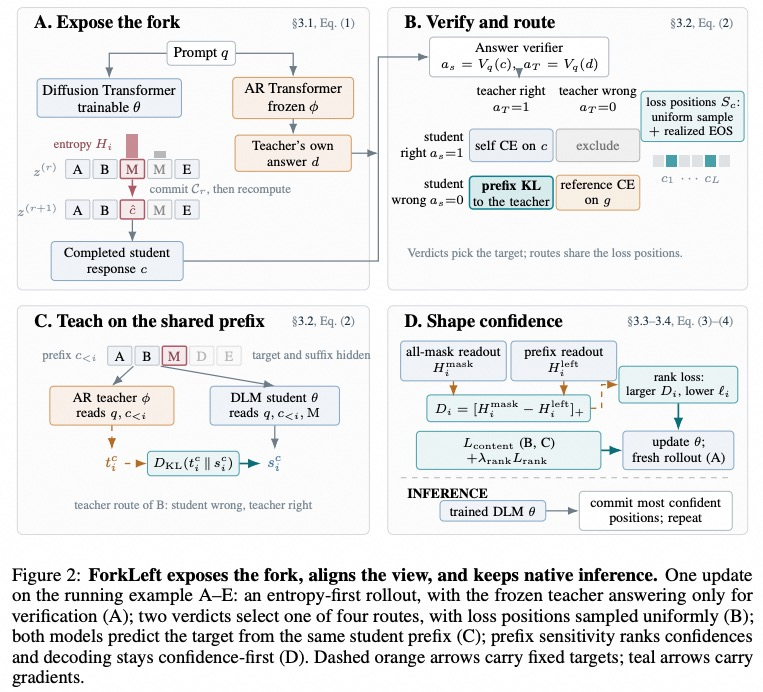
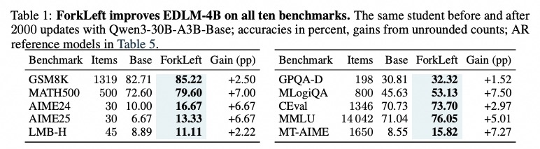

<h1 align="center">ForkLeft: Entropy-First Rollouts for Prefix-Aligned Autoregressive-to-Diffusion Distillation</h1>

<p align="center">
    <a href="https://arxiv.org/abs/2609.32448">
        
    </a>
    <a href="https://github.com/Wings-Of-Disaster/ForkLeft">
        
    </a>
</p>

## News
```2026-11-06``` 🎉 Code released.

```2026-09-26``` 🎉 Paper published: [ForkLeft: Entropy-First Rollouts for Prefix-Aligned Autoregressive-to-Diffusion Distillation](https://arxiv.org/abs/2609.32448).

## Release Plan
- [x] Paper
- [x] Code
- [ ] Pretrained checkpoints

## Introduction
Autoregressive (AR) teachers and diffusion language model (DLM) students see different context: the teacher predicts from a left prefix while the DLM conditions on both sides. ForkLeft resolves this mismatch through **prefix-aligned supervision** — both models predict each token under the same student-written left prefix — combined with **correctness-based routing** and **confidence shaping**.



## Results
ForkLeft improves EDLM-4B on **all ten benchmarks** with Qwen3-30B-A3B-Base as teacher:

| Benchmark | Base | ForkLeft | Gain |
|---|---:|---:|---:|
| GSM8K | 82.71 | **85.22** | +2.50 |
| MATH500 | 72.60 | **79.60** | +7.00 |
| AIME24 | 10.00 | **16.67** | +6.67 |
| AIME25 | 6.67 | **13.33** | +6.67 |
| GPQA-D | 30.81 | **32.32** | +1.52 |
| MLogiQA | 45.63 | **53.13** | +7.50 |
| CEval | 70.73 | **73.70** | +2.97 |
| MMLU | 71.04 | **76.05** | +5.01 |
| MT-AIME | 8.55 | **15.82** | +7.27 |
| LMB-H | 8.89 | **11.11** | +2.22 |



## Install
```bash
conda create -n forkleft python=3.12
conda activate forkleft
pip install torch transformers datasets accelerate
```

## Usage

### Training
```bash
STUDENT=<student_path> TEACHER=<teacher_path> DATA=<data.json> bash scripts/train_forkleft.sh
```

### Multi-Teacher Training
```bash
STUDENT=<student_path> TEACHER=<math_teacher> TEACHER2=<general_teacher> DATA=<data.json> bash scripts/train_forkleft.sh
```

### Evaluation
```bash
MODEL=<checkpoint_path> DATASETS=GSM8K,MATH500 bash scripts/evaluate.sh
```

## Data
Our internal training data cannot be released at this time due to licensing restrictions. The current version contains approximately 13K samples: ~81% mathematical reasoning (competition math, grade-school word problems, and RL-style math traces) and ~19% general knowledge (science QA, logic, and multilingual comprehension). Each sample is a JSON object with a question, a ground-truth answer, and a domain label. You can build a comparable dataset from public corpora such as GSM8K, MATH, and MMLU.

## Citation
```bibtex
@misc{Liu_2026_ForkLeft,
    author    = {Junming Liu and Jicheng Wang and Yifeng He and Hao Chen and Jianzhong Qi},
    title     = {ForkLeft: Entropy-First Rollouts for Prefix-Aligned Autoregressive-to-Diffusion Distillation},
    year      = {2026},
    eprint    = {2609.32448},
    archivePrefix = {arXiv},
    primaryClass  = {cs.AI},
    url       = {https://arxiv.org/abs/2609.32448}
}
```

## License
This project is licensed under the MIT License — see the [LICENSE](LICENSE) file for details.
